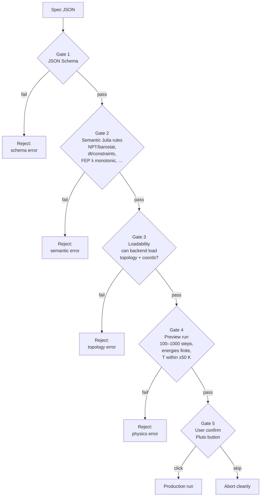
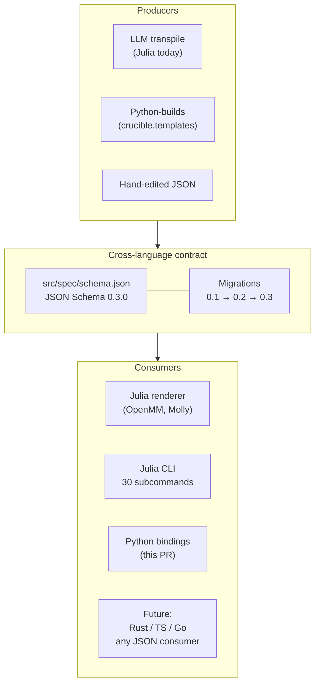
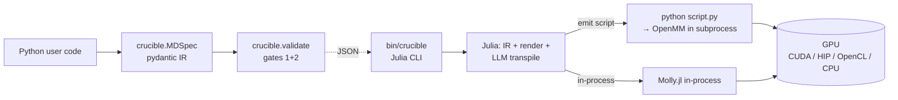
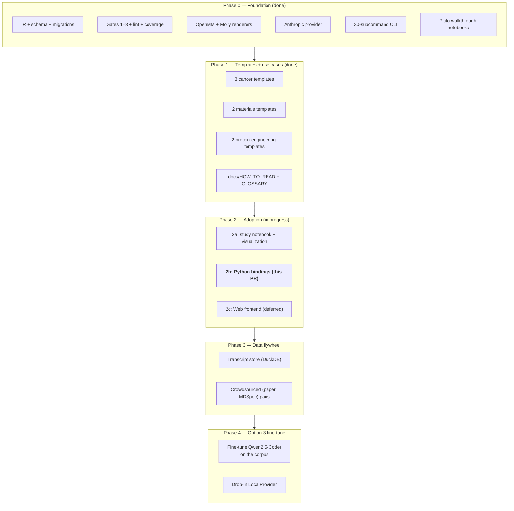
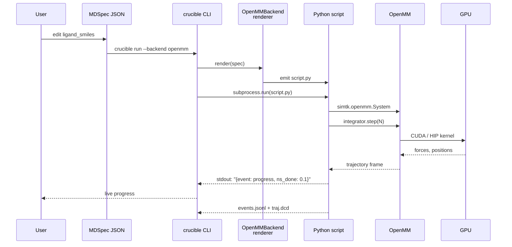

# Architecture

This document is the visual companion to `musings/why_ir_as_contract.md`,
`musings/why_subprocess_over_pythoncall.md`, and `docs/PLAN.md`. Diagrams
are Mermaid — GitHub renders them natively. If you're reading the raw
file, the code blocks are the source.

## 1. The pipeline at a glance

What a Crucible session looks like end-to-end, from "PDF dropped on a
Pluto cell" to "GPU running a simulation":

```mermaid
flowchart LR
    Paper[("paper.pdf<br/>arXiv ID<br/>bioRxiv DOI<br/>pasted notes")]
    Adapter[Input adapter<br/>PDF / arXiv / bioRxiv / Notes]
    LLM["LLM transpile<br/><i>Anthropic / Local</i>"]
    IR{{"MDSpec JSON<br/><b>schema-validated</b>"}}
    Gates[5-gate validation]
    Renderer[Renderer<br/>OpenMM | Molly]
    Script["Rendered script<br/><i>the deliverable</i>"]
    Backend[Backend run<br/>OpenMM subprocess<br/>Molly in-process]
    Artifacts[(workdir/<br/>events.jsonl<br/>traj.dcd<br/>state.xml)]

    Paper --> Adapter --> LLM --> IR
    IR --> Gates --> Renderer --> Script --> Backend --> Artifacts
    Gates -. fails .-> User([User])
    Backend -. progress events .-> Artifacts
```

The horizontal arrow IR → Gates → Renderer is the **load-bearing
contract**: every layer to the right of IR is downstream of pure JSON,
which is why the polyglot story works
(`musings/ecosystem_alternatives.md`).

## 2. The five validation gates

Each gate is sequential and non-skippable; if N fails, N+1 doesn't run.
Gates 1-2 are pure (no LLM, no GPU). Gate 3 hits the backend.



Why sequencing matters: gate 4 (preview run) costs CPU/GPU minutes;
gate 1 costs microseconds. Failing fast at the cheap gates keeps the
"reject before allocating GPU time" promise.

## 3. The IR is the cross-language contract

Each row of the table below is one layer, the wire format it speaks,
and the languages that already implement (or could implement) it. This
is the architecture the polyglot story rests on:



Both Julia and Python validate against the same `schema.json`. Both
sides ship a migration registry indexed by `(from_version, to_version)`.
A schema bump is a coordinated PR that updates the file plus both
language ports.

## 4. Subprocess-as-integration-boundary

`musings/why_subprocess_over_pythoncall.md` says the integration
boundary should be at the **process layer**, not the function-call
layer. The Python bindings extend this in both directions:



Two process boundaries, both honored: Python ↔ Julia (for
render/run/serve), and Julia ↔ Python-script-running-OpenMM. Each
boundary is JSON or subprocess-stdin/stdout. No native interop, no
shared address space, no version-pinning headaches. The cost is one
fork()/exec() per operation — negligible against a multi-hour MD run.

## 5. Adoption-plan layout

How the existing pieces line up against `docs/ADOPTION_PLAN.md` Phases
0–4. This is the strategic shape, mapped onto the codebase:



Path 3 (this PR) is the load-bearing piece of Phase 2b: the IR is what
Python users most want to manipulate programmatically; the renderer
and LLM transpile remain Julia, called via subprocess.

## 6. Data flow at a single timestep

For the curious: how a single dynamics step actually flows from the
IR through the stack:



The `events.jsonl` is structured (one JSON object per line). It's the
narrow waist that lets `crucible events` and the Pluto study notebook
both consume the same wire format. See `src/spec/Events.jl` for the
schema.

## 7. Where to read more

- `docs/PLAN.md` — operational sprint plan, milestones v0.1 / v0.2 / v0.3.
- `docs/ADOPTION_PLAN.md` — the 18-month strategic roadmap.
- `docs/HOW_TO_READ.md` — role-specific reading guides.
- `docs/POWER_USERS.md` — extending Crucible (lint rules, templates,
  schema bumps, Python bindings).
- `musings/why_ir_as_contract.md` — why the LLM emits JSON, not Python.
- `musings/why_subprocess_over_pythoncall.md` — why the integration
  boundary is the process layer.
- `musings/ecosystem_alternatives.md` — why Julia for the core, Python
  bindings for adoption.
